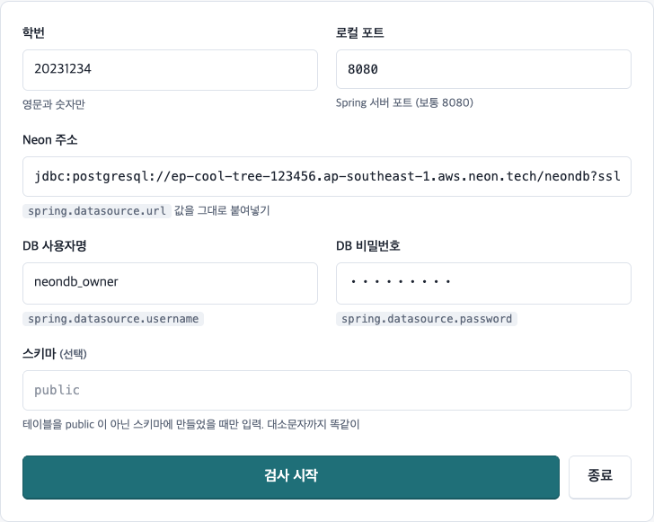
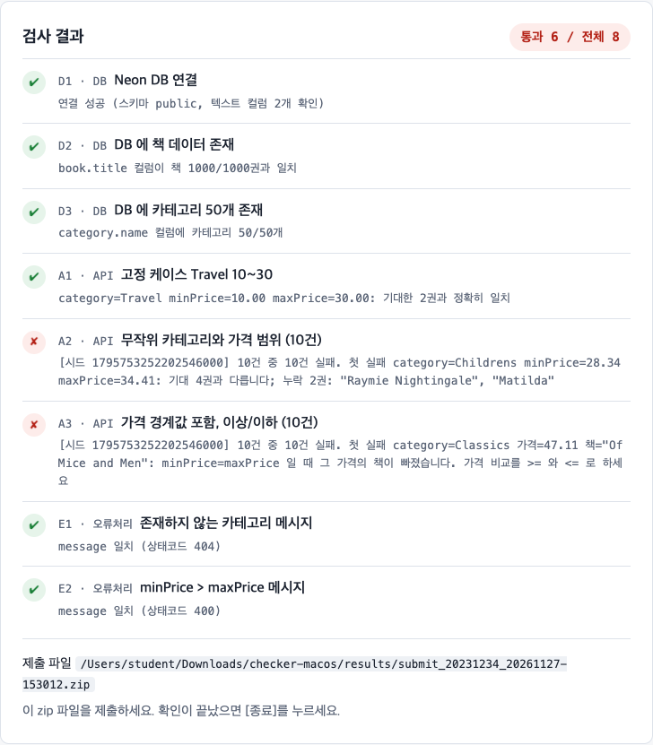
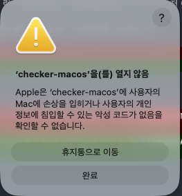
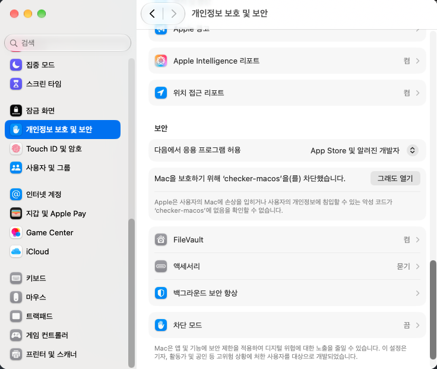
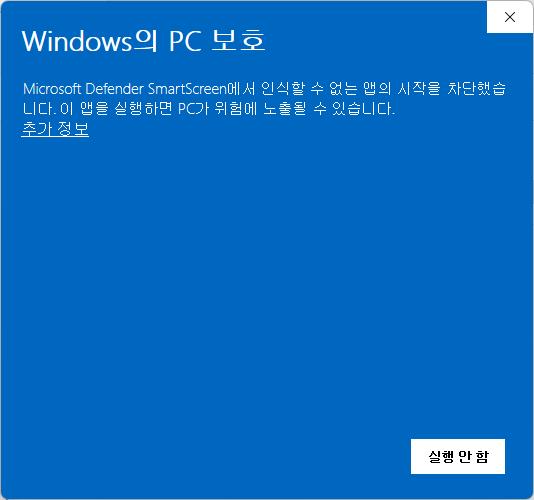
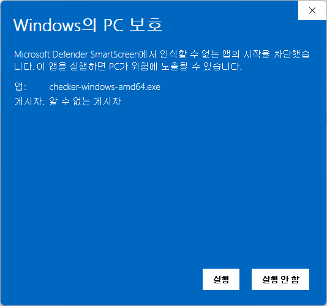

# DB 과제 채점기 사용법

## 실행 방법

1. Spring Boot 서버를 먼저 실행합니다.
2. 받은 zip을 풀고 채점기를 더블클릭하면 브라우저에 입력 창이 열립니다. 처음 실행할 때 경고가 뜨면 아래 [OS별 대응](#os별-실행방법)을 따라 한 번만 허용하세요.
3. 학번, 포트(보통 `8080`), `application.properties`의 DB 주소·사용자명·비밀번호를 넣고 **[검사 시작]** 을 누릅니다.

   

   Neon 주소는 `spring.datasource.url` 값을 그대로 붙여넣습니다. 스키마는 `public`이 아닌 곳에 테이블을 만들었을 때만 넣습니다.

4. ✘가 있으면 이유를 보고 고친 뒤 다시 검사합니다. 맨 아래에 결과 zip 파일의 위치가 나옵니다.

   

   위는 가격을 `>`, `<` 로 비교해서 A2·A3가 실패한 예시입니다. 이유에 나온 대로 `>=`, `<=` 로 고치면 통과합니다.

5. 끝나면 **[종료]** 를 누릅니다. 결과 파일은 채점기 옆 `results` 폴더에 `submit_학번_날짜-시각.zip`으로 생깁니다. 검사할 때마다 새 파일이 생기니 가장 최근 파일을 쓰세요.

## OS별 실행방법

### macOS
 

 

- **zip은 Finder에서 더블클릭으로 풉니다.** 다른 압축 프로그램이나 Windows에서 푼 뒤 옮기면 실행 권한이 빠져 열리지 않을 수 있습니다.
- **처음 실행하면 "확인할 수 없습니다" 경고가 뜹니다.** [완료]를 누르고(휴지통 아님) 시스템 설정 → 개인정보 보호 및 보안 → 아래쪽 "checker-macos이(가) 차단되었습니다" 옆 [그래도 열기] → Mac 암호 → 다시 [그래도 열기]. 한 번만 하면 됩니다.
- **더블클릭하면 터미널 창이 같이 열립니다.** 채점기 본체이므로 검사가 끝날 때까지 닫지 마세요.
- M1 이후 Mac과 Intel Mac 모두 같은 파일을 씁니다.

### Windows

- **zip을 오른쪽 클릭 → [압축 풀기] 후 실행합니다.** zip 안에서 바로 실행하면 채점기가 멈추고 압축을 풀라고 안내합니다.
- **"Windows의 PC 보호" 창이 뜨면** [추가 정보] → [실행].
- **백신이 파일을 지웠다면** Windows 보안 → 바이러스 및 위협 방지 → 보호 기록 → [디바이스에서 허용] 후 다시 받습니다.

### Linux

- 압축을 풀고 터미널에서 `./checker-linux-amd64` 를 실행합니다.
