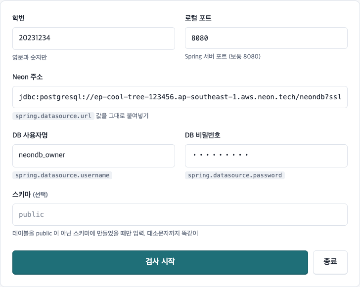
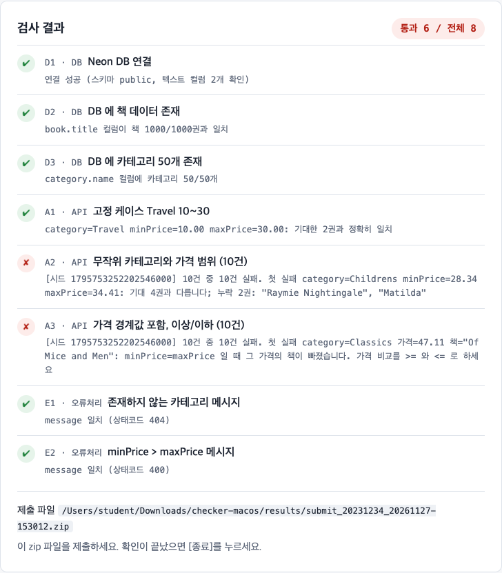

# DB 과제 채점기 안내

과제를 제출하기 전에 채점기로 내 서버를 검사하고, 채점기가 만든 결과 파일을 함께 제출합니다. 처음 실행할 때 보안 경고가 뜨니 마감 전에 미리 한 번 실행해 보세요.

> **제출 마감: 12월 4일 23:55**. 늦은 제출은 받지 않습니다.

## 제출할 것

1. **프로젝트 zip**: 과제 명세대로 빌드를 클린한 Maven 프로젝트와 README.
2. **채점 결과 zip**: 채점기 옆 `results` 폴더의 `submit_학번_날짜-시각.zip`. 여러 번 검사했다면 **가장 최근 파일** 하나를 풀지 말고 그대로 냅니다.

## 실행 방법

1. Spring Boot 서버를 먼저 실행합니다.
2. 받은 zip을 풀고 채점기를 더블클릭하면 브라우저에 입력 창이 열립니다.
3. 학번, 포트(보통 `8080`), `application.properties`의 DB 주소·사용자명·비밀번호를 넣고 **[검사 시작]** 을 누릅니다.

   

   Neon 주소는 `spring.datasource.url` 값을 그대로 붙여넣습니다. 스키마는 `public`이 아닌 곳에 테이블을 만들었을 때만 넣습니다.

4. ✘가 있으면 이유를 보고 고친 뒤 다시 검사합니다. 맨 아래에 제출할 zip 파일의 위치가 나옵니다.

   

   위는 가격을 `>`, `<` 로 비교해서 A2·A3가 실패한 예시입니다. 이유에 나온 대로 `>=`, `<=` 로 고치면 통과합니다.

## macOS 유의사항

- **zip은 Finder에서 더블클릭으로 풉니다.** 다른 압축 프로그램이나 Windows에서 푼 뒤 옮기면 실행 권한이 빠져 열리지 않을 수 있습니다.
- **처음 실행하면 "확인할 수 없습니다" 경고가 뜹니다.** [완료]를 누르고(휴지통 아님) 시스템 설정 → 개인정보 보호 및 보안 → 아래쪽 "checker-macos이(가) 차단되었습니다" 옆 [그래도 열기] → Mac 암호 → 다시 [그래도 열기]. 한 번만 하면 됩니다.
- **더블클릭하면 터미널 창이 같이 열립니다.** 채점기 본체이므로 검사가 끝날 때까지 닫지 마세요.
- **결과 파일은 채점기 옆 `results` 폴더에 생깁니다.** 정확한 위치는 결과 화면 아래에 나옵니다.
- M1 이후 Mac과 Intel Mac 모두 같은 파일을 씁니다.

## Windows · Linux

- **Windows**: zip을 오른쪽 클릭 → [압축 풀기] 후 실행합니다. zip 안에서 바로 실행하면 채점기가 멈추고 압축을 풀라고 안내합니다. "Windows의 PC 보호" 창이 뜨면 [추가 정보] → [실행].
- **Linux**: 압축을 풀고 터미널에서 `./checker-linux-amd64`.

## 채점기가 기록하는 정보

검사 결과와 함께 컴퓨터 이름과 MAC 주소를 암호화해 기록합니다. DB 비밀번호는 저장하지 않고, DB는 읽기만 합니다.
